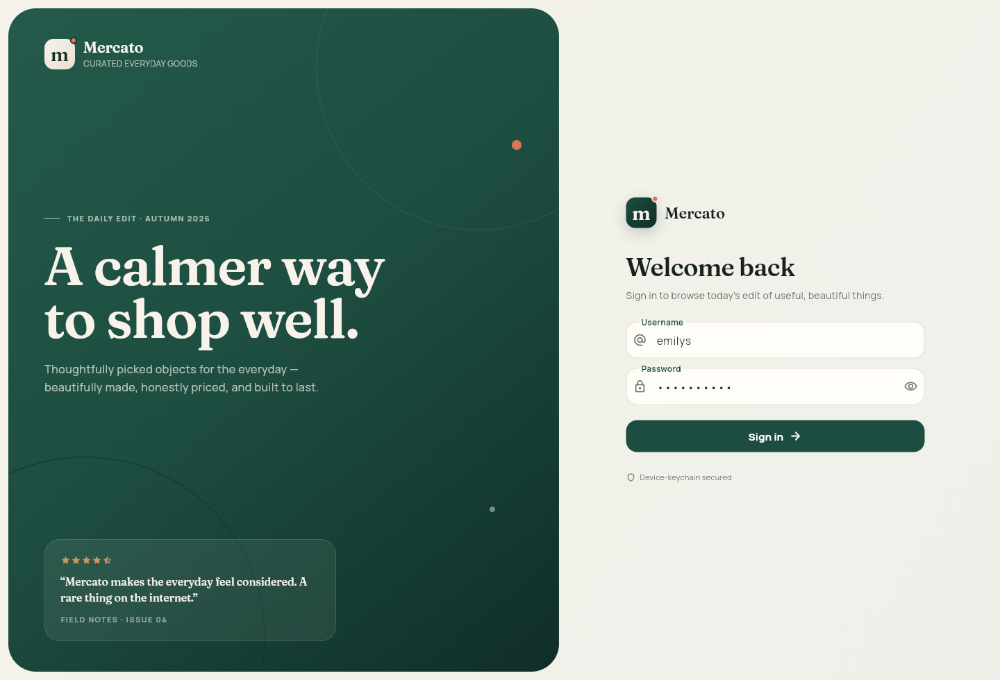
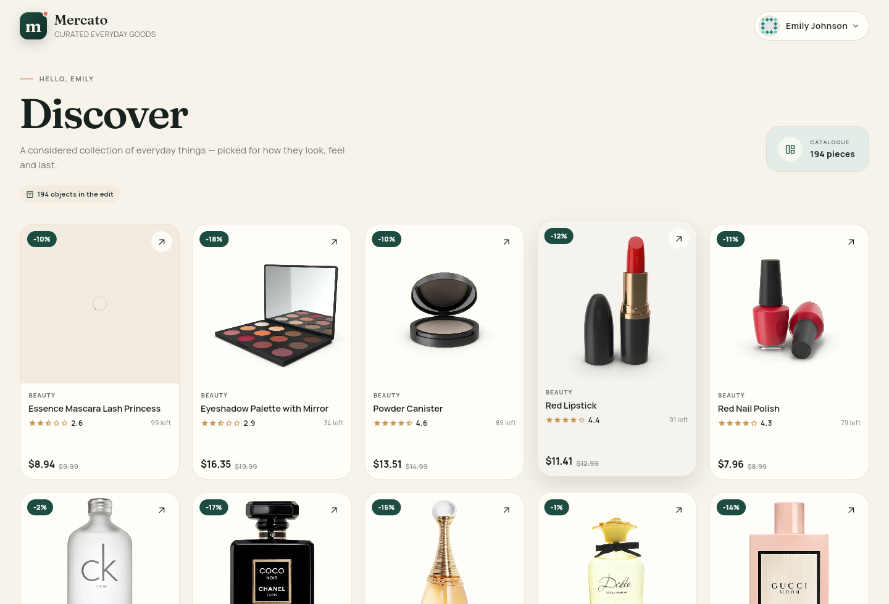
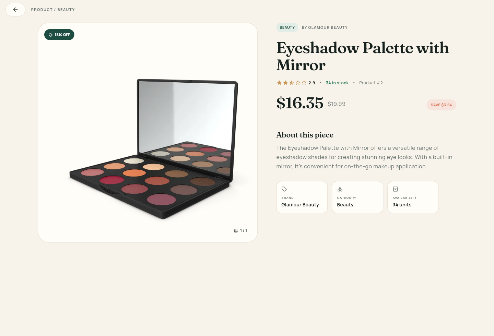
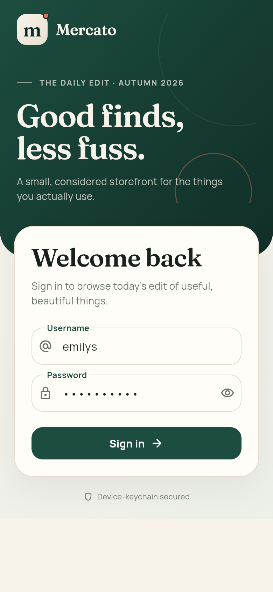
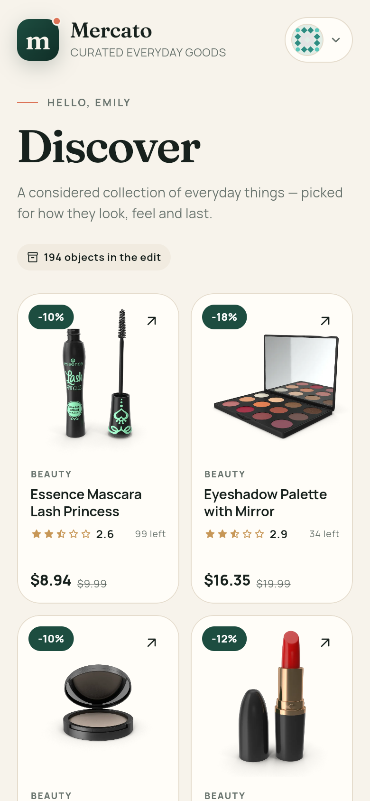
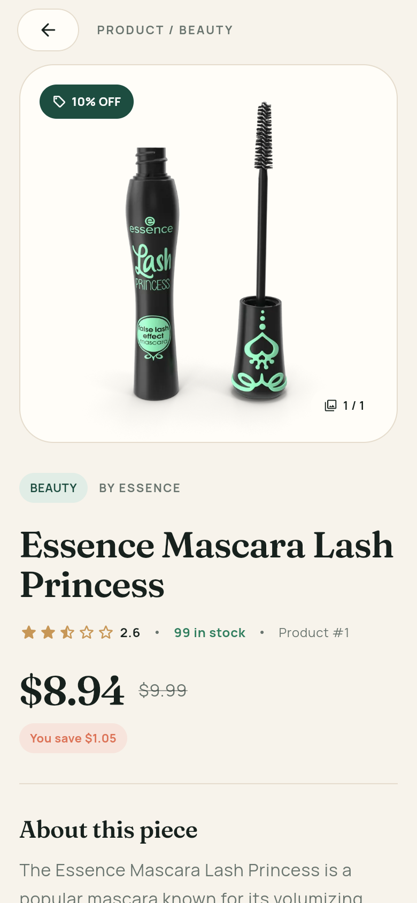

# Mercato

A small, production-shaped Flutter storefront built against the public
[DummyJSON](https://dummyjson.com/) API. It includes a secure login, a
paginated product catalogue, and a responsive product detail page.

> **Demo account:** `emilys` / `emilyspass` — pre-filled on the login screen.

## Screens

| Login | Discover | Product detail |
| --- | --- | --- |
|  |  |  |

### Mobile

| Login | Discover | Product detail |
| --- | --- | --- |
|  |  |  |

The phone layout uses a two-column product grid with a full-bleed gallery.
Dark mode follows the system setting (`docs/screenshots/login-dark.png`).

## Run it

The project is pinned to **Flutter 3.47.8** with FVM (`.fvmrc`).

```bash
fvm install
fvm flutter pub get
fvm flutter run   # pick a running Android/iOS device or Chrome
```

For web, `flutter_secure_storage` requires **localhost or HTTPS**. On iOS the
required Keychain Sharing entitlements are already included
(`ios/Runner/*.entitlements`). Android is configured with `allowBackup="false"`
for the same reason.

Tests and static analysis:

```bash
fvm flutter analyze
fvm flutter test
```

## Features

- **Login** with `POST /auth/login`, form validation, inline API errors, loading
  state, password visibility toggle, and a pre-filled demo account.
- **Secure session** — the access and refresh tokens live in platform secure
  storage (Keychain/Keystore; encrypted browser storage on web), never in plain
  `SharedPreferences`. Sessions are restored on cold start; sign-out clears
  both tokens and returns to login.
- **Transparent token renewal** — a `401` triggers a single `POST
  /auth/refresh` using the stored refresh token. Parallel failures share that
  one request, the original calls are replayed with the new access token, and a
  rejected refresh token clears the session and returns to login.
- **Product list** with skeleton loading, full-page error + retry, empty state,
  pull-to-refresh, and infinite pagination (`limit` / `skip`).
- **Pagination resilience** — failed pages keep the already-loaded products and
  expose an inline retry; refresh failures keep the old catalogue and surface a
  snackbar.
- **Product detail** fetched by id, with an image gallery, discount pricing,
  rating, stock, description and specs.
- **Responsive, themed UI** — 2–6 column grid, desktop hover lift, light/dark
  mode, bundled Manrope + Fraunces fonts, and custom app icons.

## Architecture

Feature-first **clean architecture** with unidirectional BLoC state. Dependencies
point inwards; the domain layer has no knowledge of Flutter, Dio or storage.

```
lib/
├── core/                       # shared infrastructure and UI kit
│   ├── constants/              # API endpoints & timeouts
│   ├── di/                     # get_it composition root
│   ├── error/                  # ApiException, Failure (+ mappers)
│   ├── network/                # Dio client, auth interceptor
│   ├── router/                 # GoRouter + auth redirect
│   ├── storage/                # secure token storage contract/impl
│   ├── theme/                  # colour scheme, typography, palette, spacing
│   ├── ui/                     # reusable visual widgets
│   └── utils/                  # Result<T>, formatters
└── features/
    ├── auth/
    │   ├── data/               # DTOs, remote data source, repository impl
    │   ├── domain/             # User entity, AuthRepository contract
    │   └── presentation/       # AuthBloc, splash & login pages
    └── products/
        ├── data/               # Product DTOs, remote data source, repository
        ├── domain/             # Product/ProductPage entities, contract
        └── presentation/       # list/detail blocs, pages, widgets
```

```
Widgets ──events──▶ Bloc ──▶ Repository (domain contract)
   ▲                 │             ▲
   └─────state───────┘             │ implements
                                   │
                     RepositoryImpl ──▶ RemoteDataSource ──▶ ApiClient (Dio)
                                   └──▶ AuthStorage (Keychain / Keystore)
```

### Key decisions

- **BLoC for state.** Auth is one app-level `AuthBloc`; catalogue and detail
  state are scoped to their routes via `BlocProvider`. Explicit events/states
  make the loading, empty, error and pagination transitions testable without
  widgets.
- **A `Result<T>` boundary.** `ApiException` stays in the network layer.
  Repositories translate it into a sealed `Failure` (`NetworkFailure`,
  `UnauthorizedFailure`, …) and return `Success`/`FailureResult`. Blocs never
  catch transport exceptions, and widgets only render messages.
- **Thin network layer.** `ApiClient` owns Dio configuration, bearer-token
  injection and status-code mapping. `AuthInterceptor` appends the access token
  and, on `401`, refreshes once and replays the request; concurrent `401`s
  await the same refresh (`AuthTokenRefresher`), so a burst of requests never
  rotates the token more than once. Logging records method, path, status and
  duration only — never tokens, headers or bodies.
- **Secure storage behind an interface.** `AuthStorage` is injected into the
  repository, token refresher and auth interceptor, so the plugin can be faked
  in tests. The access token, refresh token and cached profile are stored
  separately in secure storage.
- **Routing follows session state.** `GoRouter` redirects `/splash → /login →
  /products` based on `AuthBloc`, with the detail page nested under products.
  The product object is passed as route `extra` for an instant page/hero, while
  `ProductDetailBloc` still fetches canonical data by id.
- **Pagination is additive.** The list requests 12 items at a time, deduplicates
  by id, marks the end when a page is empty or total is reached, and guards
  against overlapping requests. Pull-to-refresh is awaited by the
  `RefreshIndicator` via a completer carried by the refresh event.
- **UI as a system.** Rather than hard-coded colours, a `ThemeExtension`
  (`AppPalette`) supplies semantic colours for both brightnesses. Layout
  breakpoints are computed from available width, and all states share the same
  header so the page never “jumps”.

### API calls used

| Purpose | Endpoint |
| --- | --- |
| Sign in | `POST /auth/login` |
| Renew session | `POST /auth/refresh` |
| Catalogue | `GET /products?limit=12&skip={n}&select=…` |
| Detail | `GET /products/{id}` |

Login and refresh request `expiresInMins: 60`. The refresh token returned by
login is persisted and exchanged for a new access/refresh pair when a request
returns `401`. DummyJSON has no logout endpoint, so sign-out is local: both
tokens and the cached profile are removed from secure storage.

## Tests

- `AuthBloc`: restore, successful login, rejected login, logout, session expiry.
- `AuthInterceptor` / `AuthTokenRefresher`: token injection, 401 refresh and
  replay, parallel-request queueing, rejected and unreachable refresh.
- `ProductListBloc`: initial load, first-page failure, pagination append, page
  failure, refresh success/failure, end-of-list guard, refresh completer.
- `ProductDetailBloc`: success and failure.
- Widget test: the login page submits the pre-filled demo credentials.
